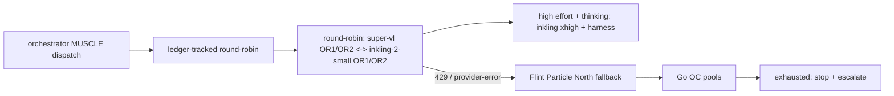

# Spec — Free-first dynamic round-robin fix (2026-11-17)

**Status**: approved
**Approved by human**: go-ahead 2026-11-17
**Approved at**: 2026-11-17T14:30:27Z
**Related plan**: `docs/plans/2026-11-17-free-roundrobin.md`
**Date**: 2026-11-17
**Debt**: code-reviewer high — missing spec closeout for the free round-robin fix.

## Goal

Close the free-first routing debt with a dynamic round-robin design: super-VL
<-> inkling-2-small primary across OpenRouter OR1/OR2, Flint/Particle/North
fallback, Go+OC pools, allowlist-only selection (deny-rest-by-default;
allowlist = exact IDs + family-prefix stems with -free/:free suffix; No
substring deny), high effort + thinking (inkling-2-small at `xhigh` + agent
harness), paid fallback kept (cap + ask-to-extend). Free-only; never auto-paid;
no secrets. Human decision 2026-11-17: both super-VL and inkling-2-small in the
round-robin; allowlist replaces the substring denylist.

## Non-goals

- No auto-paid dispatch; paid fallback only after admission passes + explicit
  spend approval + ask-to-extend; exhaustion without approval → stop + escalate.
- No runtime routing changes beyond the routing table / denylist / pins.
- No network probes beyond cheap `GET /api/v1/models` + `max_tokens:1` completion.
- No OpenCode modification.

## Alternatives

| Option | Verdict | Why |
|---|---|---|
| A. Ledger-tracked OR1/OR2 round-robin (super-VL <-> inkling-2-small primary) | **Chosen** | ~2,000 free req/day pooled; two-model redundancy, no blind keys |
| B. Blind round-robin (keys hidden) | Rejected | Design 0004; alternation ledger-tracked instead |
| C. Single account | Rejected | Halves quota, no redundancy |
| D. Per-dispatch override alternation | Deferred | Unverified in v2.2.6 subagent path; revisit via dashboard activity |

## Trade-offs

- Free quality variance + outages → fallback chains + Go fallback.
- Orchestrator complexity → ledger-tracked alternation.
- Latency; prompt-training exposure (traffic rules; NVIDIA non-sensitive only).

## Requirements

### REQ-1 — Free-only admission
Free-pool resolver admits only cost-0 + tool-call-capable + allowlisted,
non-secret free models; allowlist and paid exclusion enforced.

### REQ-2 — Round-robin super-VL <-> inkling-2-small OR1/OR2 + high effort/thinking
MUSCLE dispatches route free-first with a ledger-tracked round-robin across the
super-VL OR1/OR2 and inkling-2-small OR1/OR2 links, same-model-other-account
first on `429`. Effort: `high` + thinking for super-VL where valuable;
inkling-2-small requires `xhigh` effort + thinking AND an agent harness
(mini-swe-agent/stirrup) — no harness → skip the model.

### REQ-3 — Fallback chain on 429/provider-error
Same-model-other-account first, then next re-discovered free model
(Flint/Particle/North, Go/OC); exhaustion → stop + escalate.

### REQ-4 — Allowlist-only MUSCLE selection (deny-rest-by-default)
Selectable set = explicit allowlist of routing-table IDs (exact IDs +
family-prefix stems; stems match only with a `-free`/`:free` suffix); every
other model is denied by default. No substring deny (deny is
deny-rest-by-default). `muse-spark*`, `poolside/laguna*`, `liquid/lfm*`, and
content-safety no-tools models are not allowlisted (no -free/:free stem);
`thinkingmachines/inkling-2-small:free` is allowlisted behind the xhigh +
harness gate (dispatch-gated: orchestrator must use harness else skip).

### REQ-5 — Paid fallback containment
Paid fallback kept behind cap + ask-to-extend; never auto-paid.

## Trace

| REQ | Design / plan task | Test / verify |
|-----|--------------------|---------------|
| REQ-1 | T1–T2 (free resolver) | `node --test tests/eval/free-models.mjs` |
| REQ-2 | T2–T3 (cooldown + tiered effort) | `node --test tests/opencode/test-free-rotation-cooldown.mjs tests/opencode/test-tiered-reasoning.mjs` |
| REQ-3 | T3 (fallback chain) | `node --test tests/opencode/test-free-rotation-cooldown.mjs` |
| REQ-4 | T1–T2 (allowlist) | `node --test tests/eval/free-models.mjs` |
| REQ-5 | T3 (paid containment) | `node --test tests/opencode/test-tiered-reasoning.mjs` |

## Review findings

Full record: design 0004 quota-aware routing + free-rotation-cooldown spec.
Dispositions:

| ID | Disposition | Change |
|---|---|---|
| F1 quota math | Accept | ~2,000 free req/day supports ~10–20 sessions/day/account |
| F2 single-provider fragility | Accept | Fallback chains + Go fallback required |
| F3 Flint/Gemma outage | Accept | Fallback chain on 429/provider-error |
| F4 ledger operability | Accept | Ledger shows which model/account did what |

## Leading indicators

- Go-plan usage delta (free% rising toward desired).
- Fallback frequency per dispatch.
- 429-escalation count.
- Issues caught pre-implementation (denylist violations in live use).

## Design

## Verification

Docs-only spec; no runnable tests. Verified via companion plan Tasks 1–5:
`node --test tests/eval/free-models.mjs` (0), full-suite tail, lint (0).
`npm run verify` unchanged.
