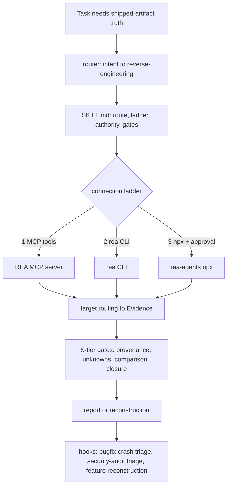

# Reverse-Engineering Capability — Design (Architectural)

Date: 2026-10-13 · Status: APPROVED 2026-10-13 · Pipeline: feature · Boundary: skill + command + references only; no plugin code, no new deps, no engine installs

## Goal

sdlc-lean gains the ability to reverse engineer any shipped artifact — native binaries, packaged apps (Electron/APK/IPA/.NET/WASM/EVM), firmware, databases, network/signal captures — to SOTA quality: evidence-linked explanations and reconstructions that survive validation, with unknowns kept explicit.

Engine: **REA** (`rea-agents`, npm, MIT, local-only MCP + CLI, pinned 6.4.0 @ commit `2a61deafc632079d10c572bc09e99233826516a3`). sdlc-lean ships the routing, evidence discipline, S-tier validation gates, and a best-of-competitor fallback matrix. REA is not vendored and not auto-installed.

## Non-goals

- Vendoring REA code or its ~62KB upstream skill (drift vs its release cadence; MIT pin + citation instead).
- Auto-installing REA or analysis engines (Hopper/Ghidra/IDA/JADX/binwalk/…) — approval-gated via `acquiring-capabilities`.
- Protection bypass, license circumvention, or analysis of unauthorized targets.
- New runtime dependencies, plugin changes, bootstrap growth.

## Alternatives considered

| Option | Verdict |
|---|---|
| **REA engine + thin sdlc-lean skill** | ✅ selected — local-only, 18+ target classes, evidence-provenance model, MIT, official OpenCode client support (`rea setup --client opencode` writes `mcp.rea`, V1+V2 compatible) |
| Vendor REA's skill | ❌ duplicates ~62KB, drifts on every REA release, double-triggers with ours |
| DIY tooling — adopt `bethington/ghidra-mcp` (209 tools) as base | ❌ native-only, no evidence model, heavy setup; kept as matrix fallback |
| IDA-based base (Hex-Rays official `ida-mcp` / `mrexodia/ida-pro-mcp`) | ❌ paid IDA license; kept as optional REA provider |
| Docs-only (no skill) | ❌ no routing, no gates, no pipeline integration |
| Binary Ninja Sidekick (commercial) | ❌ proprietary/cloud; its verification-agent model is adapted as a gate |

## Architecture

| Component | Path | Role | Interface |
|---|---|---|---|
| Skill | `.opencode/skills/reverse-engineering/SKILL.md` | Trigger, connection ladder, authority rules, gate summary, pipeline hooks | Reads references on demand; drives REA MCP tools or CLI |
| Target routing | `references/target-routing.md` | Full route table (28 rows) → REA tool/CLI route + recovery | Docs pinned @ `2a61dea`; release-6.4.0 availability noted; server schema is the contract |
| Toolchain matrix | `references/toolchain-matrix.md` | Per-class SOTA primary/fallback tools; what REA lacks (symbolic, fuzzing, hardware) | URLs + license + status per tool |
| Validation gates | `references/reconstruction-validation.md` | S-tier acceptance ladder + known failure modes | Verdicts per claim: draft → verified/rejected |
| Attribution | `references/ATTRIBUTION.md` | REA MIT pin + adapted model sources + tool citations | Hash/commit/version pins |
| Command | `.opencode/commands/reverse-engineer.md` | Deterministic read-only entry | `agent: plan`, matches `/security-audit` precedent |
| Wiring | router line · `USAGE.md` · `README.md` · `trusted-sources.md` · `CHANGELOG.md` · `eval/probes.mjs` | Routing + suite inventory truth + trigger probe | `npm run verify`, `npm run eval` (dry) |

Consumes: REA MCP tool list (server-advertised; e.g. `analyze_javascript_application`, `open_binary`, `inspect_android_package`, `decode_signal_recording`) or CLI (`rea analyze …`). Env: Node 22.x ≥22.19 / 24.x ≥24.11 (local: v24.19.0 ✓); providers bring-your-own; `rea doctor` diagnoses. Produces: evidence-linked findings; reconstructions with declared non-established claims.

## Best-of extraction (competitor study, 2026-10-13)

| Source | What is taken | Where it lands |
|---|---|---|
| REA (188.7k★, MIT) | evidence grading (observations/derivations/inferences/unknowns), coverage + limitations, retained-evidence paging, `record_unknown`, comparison semantics | SKILL.md + `target-routing.md` |
| Binary Ninja Sidekick (commercial) | independent verification pass: every claim `draft → verified/rejected` | `reconstruction-validation.md` |
| ReVa (Apache-2.0) | small-call, context-rot-resistant tool discipline | SKILL.md |
| GhidrAssistMCP (MIT) | explicit read-only vs mutating distinction | SKILL.md authority rules |
| Trail of Bits Buttercup (AGPL, archetype only) | closed loop emulate/fuzz → analyze → patch as escalation path | `toolchain-matrix.md` |
| radare2 r2mcp/r2ai (MIT) | sandbox / read-only modes mindset | SKILL.md authority rules |
| dx-ball reconstruction (working repo, cited) | byte-exact compiler replay oracle; per-oracle "does not establish" declarations | `reconstruction-validation.md` |
| DecompileBench + Decompile-Diverge (arxiv) | runtime differential substitution; fuzz-driven differential oracle beyond shipped tests | `reconstruction-validation.md` |
| ReSym / GENNM (CCS'24, NDSS'25) | cross-check aggregation over multiple LLM passes before accepting artifacts | `reconstruction-validation.md` |

## S-tier acceptance bar (definition of "SOTA S-tier")

1. Every claim is graded and evidence-linked; unknowns are recorded, never filled by hallucination.
2. A reconstruction closes only with machine-checkable proof: byte-exact replay (pinned toolchain), else behavioral differential beyond shipped tests, else it is delivered as declared-partial with non-established claims listed.
3. Fail-closed aggregation: `unknown`/`truncated`/`skipped` never aggregates to `pass`.
4. Independent verification pass before delivery; contradictions stay visible.
5. Score dimensions stay separate: byte-exact count · semantic acceptance count · comprehension rubric.

## Lean check

| Part | Rung | Why |
|---|---|---|
| Engine | 2/5 | Reuse REA (local, mature, MIT); build nothing |
| Skill + references | 6 | Minimum that changes behavior; references load on demand |
| Command | 6 | 6 lines; matches every-pipeline-has-a-command pattern |
| Wiring | 1 | Suite inventory must stay true |
| Not done | — | No plugin code, no new deps, no vendoring, no engine installs |

## Verification

1. `npm run verify` green; lint reports 39 skills, 0 failures; bootstrap unchanged (<5KB test).
2. Target-class coverage: every REA class has a routing row.
3. Trigger pressure test via fresh-context reviewer: RE scenarios fire the skill; source-repo scenarios do not.
4. Attribution pins present; no installs executed during build.
5. `npm run eval` dry lists the new probe.

## Open questions

None blocking. REA MCP registration: user approved — run post-build, `--dry-run` first, `--skill=false` so this skill stays the single entry point.
